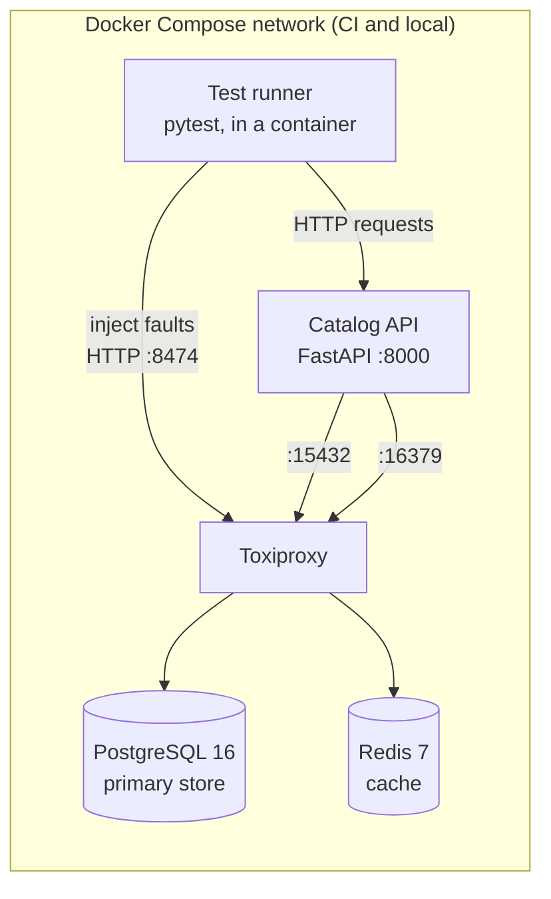
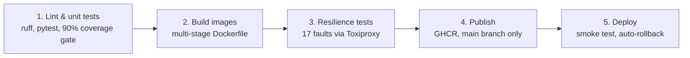

# Automated Resilience Testing in a Containerized CI Pipeline

### Using Toxiproxy and Docker Compose

[](https://github.com/OWNER/REPO/actions/workflows/ci-cd.yml)
<!-- After pushing, replace OWNER/REPO above with your GitHub username and repository name. -->

Most CI pipelines prove that an application works when everything around it works. This pipeline also proves that the application **keeps working, or fails safely, when its database and cache are slow, down or flaky**. On every push it starts the whole stack with Docker Compose, puts [Toxiproxy](https://github.com/Shopify/toxiproxy) between the app and its dependencies, injects 17 real network faults, and blocks the release if the app misses any of its resilience objectives.

| Team member | Roll number |
|---|---|
| Neeraj Apraj | 16010123212 |
| Oshan Shah | 16010123223 |
| Praneet Sharna | 16010123237 |

**Contents:** [Problem](#the-problem) · [Architecture](#architecture) · [Pipeline](#the-cicd-pipeline) · [Resilience patterns](#resilience-patterns-in-the-application) · [Fault-injection suite](#the-fault-injection-suite) · [Testing the tests](#testing-the-tests) · [Run locally](#run-it-locally) · [GitHub setup](#put-it-on-github) · [Deployment](#deployment-stage-5) · [Jenkins](#jenkins-optional) · [Configuration](#configuration) · [Structure](#project-structure) · [Troubleshooting](#troubleshooting)

More detail: [docs/DESIGN.md](docs/DESIGN.md) (design decisions and findings) and [docs/DEMO_GUIDE.md](docs/DEMO_GUIDE.md) (the live demonstration script).

---

## The problem

Production incidents rarely come from code that is wrong on the happy path. They come from a dependency that becomes slow, a cache that disappears, or a database failover that drops every connection, and from an application that responds by hanging, piling up requests or returning errors for data it already had. Ordinary unit and integration tests never exercise these conditions, so nothing stops a release that would fall over in the first real outage.

This project treats resilience as a testable requirement. The application implements standard resilience patterns, and the pipeline verifies them against real faults on every change, as a required check that can block a merge.

## Architecture

The application is a product catalog API (Python, FastAPI) with PostgreSQL as its primary store and Redis as a cache. In the test environment every connection to PostgreSQL and Redis passes through Toxiproxy, a TCP proxy that can add latency, drop connections, swallow data or throttle bandwidth on command, through an HTTP API.



Production (stage 5) runs the same image without Toxiproxy: the app connects to PostgreSQL and Redis directly ([deploy/docker-compose.prod.yml](deploy/docker-compose.prod.yml)).

The app serves a live dashboard at `/` that draws the request path as a circuit schematic: when a circuit breaker opens, its switch opens on screen and the wire behind it goes dark. Interactive API docs are at `/docs`.

## The CI/CD pipeline

Defined in [.github/workflows/ci-cd.yml](.github/workflows/ci-cd.yml). The image is built **once**; the exact image that passes the fault-injection suite is the one that is published and deployed.



| Stage | What happens | Fails the pipeline when |
|---|---|---|
| 1. Lint & unit tests | `ruff` lint and format checks; 94 unit tests with fakes for PostgreSQL and Redis | lint errors, any failing test, coverage below 90% |
| 2. Build images | Builds the production image (non-root, health-checked) and the test-runner image from one Dockerfile; exports both for later stages | the build fails |
| 3. Resilience tests | Starts PostgreSQL, Redis, Toxiproxy and the app with Compose; the containerised test runner injects 17 faults; a scorecard is posted on the run page | any resilience objective is missed |
| 4. Publish | Pushes the tested image to GitHub Container Registry as `sha-<commit>` and `latest` | the push fails |
| 5. Deploy | On a self-hosted runner: `docker compose up`, then a smoke test checks readiness, data and that the running version equals the commit; rolls back to the previous image if anything fails | the new version is unhealthy (even after a successful rollback) |

Stages 4 and 5 run only for the `main` branch; pull requests run stages 1 to 3, so a change that breaks resilience cannot be merged once branch protection is on. Each run's page shows a coverage table and the resilience scorecard, and the JUnit reports and stack logs are attached as artifacts.

## Resilience patterns in the application

| Pattern | Where | What it prevents |
|---|---|---|
| Deadline on every database operation (1 s) | [catalog/db.py](catalog/db.py) | Requests hanging on a slow database. The deadline covers the whole operation, because a query needs 3 network round trips and a new connection 6. |
| Short Redis timeout (250 ms), library retries disabled | [catalog/cache.py](catalog/cache.py) | A slow cache slowing down every request. redis-py's defaults (5 s timeout, 10 retries) could stall a request for close to a minute. |
| Retry with exponential backoff and jitter, for reads and connection errors only | [catalog/resilience.py](catalog/resilience.py), [catalog/service.py](catalog/service.py) | Transient drops (for example a failover) surfacing as errors. Writes and timeouts are never retried: a retried write can duplicate data, and retrying a slow database only adds delay. |
| Circuit breaker per dependency | [catalog/resilience.py](catalog/resilience.py) | Waiting on a dead dependency again and again. After 3 failures calls fail instantly; one trial call tests for recovery. |
| Cache-aside with serve-stale-on-error | [catalog/service.py](catalog/service.py) | Errors for data the service already has: when PostgreSQL is down, the last cached copy is served and marked `X-Data-Source: stale-cache`. |
| Optional cache | [catalog/service.py](catalog/service.py) | The cache becoming a single point of failure: every Redis error is absorbed and the request continues without it. |
| Liveness vs readiness | [catalog/api.py](catalog/api.py) | Restarting a healthy process because a dependency is down. `/health/live` checks the process; `/health/ready` reports `ready`, `degraded` or `unavailable`. |
| `503` with `Retry-After` | [catalog/api.py](catalog/api.py) | Clients retrying blindly, and 500 errors for an expected condition. |

## The fault-injection suite

[tests/resilience/](tests/resilience/) contains black-box tests that talk to the running stack over HTTP. Each one injects a fault through Toxiproxy's API, measures what a client experiences, and removes the fault. Pass/fail thresholds are fixed **service-level objectives** defined in the tests (for example "any answer within 2 s while PostgreSQL is slow"), not values read from the app, so loosening a timeout in the configuration makes the suite fail instead of quietly adjusting.

| Scenario | Fault injected (Toxiproxy) | The app must | Example result |
|---|---|---|---|
| All dependencies healthy | none | report ready, both circuits closed | ready |
| Cache-aside read path | none | read from PostgreSQL, then from Redis | database, then cache |
| Redis answers 2 s late | `latency` 2000 ms | answer within 1.25 s from PostgreSQL | 200 in 0.51 s |
| Redis is down | proxy disabled | keep reads and writes working, readiness `degraded` | 200, 201, degraded |
| Redis never replies | `timeout` (black hole) | answer within 1.25 s | 200 in 0.51 s |
| Redis stays slow | sustained `latency` | open the Redis circuit, then skip Redis | reads in 3 ms |
| PostgreSQL answers 3 s late | `latency` 3000 ms | fail fast with 503 and Retry-After within 2 s | 503 in 1.00 s |
| Every PostgreSQL round trip is a little slow | `latency` 700 ms | stop at the deadline even though each read is under the timeout | 503 in 1.00 s |
| PostgreSQL is slow but within budget | `latency` 150 ms | succeed without tripping the circuit | 200 in 0.46 s |
| PostgreSQL is down, product read before | proxy disabled | serve the stale cached copy | 200 stale-cache |
| PostgreSQL is down under sustained traffic | proxy disabled | open the circuit within 5 failures, then reject in < 0.25 s | open after 3; 2 ms |
| Write while PostgreSQL is down | proxy disabled | return 503, never 500 | 503 |
| All database connections drop at once | disable + re-enable | replace dead pooled connections transparently | 200 after 1 retry |
| Fragmented network | `slicer` (~16-byte packets) | return data identical to what was stored | identical |
| Throttled network | `bandwidth` 8 KB/s | return data identical to what was stored | identical |
| Recovery after a PostgreSQL outage | outage, then restore | recover on its own within 5 s | 2.15 s |
| Recovery after a Redis outage | outage, then restore | use the cache again within 5 s | 2.19 s |

The "Example result" column comes from one run; your pipeline posts its own measurements in the scorecard on every run.

## Testing the tests

A test suite is only useful if it fails when the code gets worse. To check that, eight realistic regressions ("mutants") were introduced one at a time and the pipeline was run against each:

| Regression | Kind | Stage 1 (unit tests) | Stage 3 (resilience tests) |
|---|---|---|---|
| A. Redis timeout loosened to the library default (5 s) | configuration | not caught | caught (3 scenarios) |
| B. Database timeout raised to 10 s | configuration | not caught | caught (2 scenarios) |
| C. Database retries disabled | configuration | not caught | caught (1 scenario) |
| D. redis-py's 10 default retries left on | code | caught | caught (3 scenarios) |
| E. Circuit breaker effectively disabled | configuration | not caught | caught (4 scenarios) |
| F. Stale-cache fallback removed | code | caught | caught (1 scenario) |
| G. Redis errors no longer absorbed | code | caught | caught (5 scenarios) |
| H. Whole-operation deadline removed | code | caught | caught (1 scenario) |

Every regression was caught: a mutation score of 100%. The pattern is the main result of the project. Unit tests catch mistakes in the **code**, but every **configuration** regression passed all 94 unit tests and was caught only by fault injection against the real, configured stack. Regression B is the clearest example: a 3-second database slowdown made users wait **9 seconds**, because each query makes three network round trips and each one paid the delay.

## Run it locally

You need Docker (Docker Desktop on Windows or macOS, Docker Engine on Linux) with Compose **2.23 or newer** (`docker compose version`), and Git. Windows users: run the commands in Git Bash or WSL2.

**Start the stack and open the dashboard**

```bash
docker compose up -d --build
```

- Dashboard: <http://localhost:8000>, then press **Send test traffic**
- API docs: <http://localhost:8000/docs>
- Live fault demo (keep the dashboard open next to it): `bash scripts/chaos-demo.sh`
- Stop everything: `docker compose down` (add `-v` to also delete the database)

**Run the whole pipeline locally (stages 1 to 3), with only Docker**

```bash
bash scripts/pipeline.sh            # or: unit | build | resilience
```

Reports land in `reports/`: JUnit XML, coverage, `resilience-scorecard.md` and the stack logs.

**Or run the resilience suite by hand**

```bash
docker compose -f docker-compose.yml -f docker-compose.ci.yml --profile test build
docker compose -f docker-compose.yml -f docker-compose.ci.yml up -d --wait
docker compose -f docker-compose.yml -f docker-compose.ci.yml run --rm tester
docker compose -f docker-compose.yml -f docker-compose.ci.yml down -v
```

**Unit tests without Docker** (Python 3.12)

```bash
python -m venv .venv && source .venv/bin/activate   # Windows: .venv\Scripts\activate
pip install -r requirements-dev.txt
pytest --cov=catalog
```

## Put it on GitHub

1. Create an empty repository on GitHub (public is simplest; see the note on self-hosted runners below), then push:

   ```bash
   git init -b main
   git add .
   git commit -m "Resilience testing pipeline"
   git remote add origin https://github.com/<your-username>/<repo>.git
   git push -u origin main
   ```

2. Open the **Actions** tab. Stages 1 to 4 run on the push; stage 5 shows as skipped until you set up deployment.
3. Replace `OWNER/REPO` in the badge at the top of this README.
4. Protect `main` so failing resilience tests block merges: **Settings > Branches > Add branch protection rule** (or **Rules > Rulesets**), pattern `main`, enable **Require status checks to pass**, and select `Stage 1: Lint & unit tests`, `Stage 2: Build Docker images` and `Stage 3: Resilience tests (Toxiproxy)`. Checks only appear in the list after they have run once.
5. The published image appears under the repository's **Packages**. Pull it with `docker pull ghcr.io/<owner>/<repo>:latest` (after `docker login ghcr.io`, or after making the package public in its settings).

## Deployment (stage 5)

Stage 5 runs on a **self-hosted GitHub Actions runner** installed on the machine you deploy to, so no SSH keys or cloud-specific tooling are needed. It can be a team member's laptop (Linux, macOS, or Windows through WSL2) or a cloud VM (AWS EC2, Azure for Students, Google Cloud).

1. **Install Docker** on the machine, with Compose 2.23+. On Linux, let the runner's user use Docker: `sudo usermod -aG docker $USER`, then log out and in.
   Windows: install Docker Desktop, enable WSL integration for your Ubuntu distro, and do the following steps *inside* WSL2.
2. **Register the runner**: on GitHub, open **Settings > Actions > Runners > New self-hosted runner**, choose Linux, and run the commands it shows. When `config.sh` asks for additional labels, enter `deploy`. Start it with `./run.sh`, or install it as a service with `sudo ./svc.sh install && sudo ./svc.sh start`.
3. **Enable the stage**: in **Settings > Secrets and variables > Actions**:
   - Variables: `DEPLOY_ENABLED` = `true`; optionally `APP_PUBLIC_URL`, for example `http://<vm-public-ip>:8080`
   - Secrets (optional): `PROD_DB_PASSWORD`. It is applied only when the database volume is first created.
4. **Push to `main`.** The app is served on port **8080** of the runner machine. On a cloud VM, open port 8080 in its firewall or security group.
5. **Optional approval gate**: **Settings > Environments > production > Required reviewers** pauses every deployment until a teammate approves it (free on public repositories).

Run it by hand on the target machine: `APP_IMAGE=ghcr.io/<owner>/<repo>:sha-<commit> bash scripts/deploy.sh`.

> **Security note:** GitHub recommends self-hosted runners only for private repositories, because a pull request from a fork could change the workflow to run code on your machine. On a public repository, open **Settings > Actions > General** and set fork pull request workflows to need approval for all outside contributors (the strictest option), run the runner on a machine with nothing sensitive on it, and remove the runner after the evaluation.

## Jenkins (optional)

The [Jenkinsfile](Jenkinsfile) runs the same stages by calling the same scripts ([scripts/pipeline.sh](scripts/pipeline.sh) and [scripts/deploy.sh](scripts/deploy.sh)), so both CI systems share one implementation.

1. Create a **Pipeline** (or Multibranch Pipeline) job, choose **Pipeline script from SCM**, point it at your repository, and keep the script path `Jenkinsfile`.
2. The agent needs Docker with Compose 2.23+, bash, git and curl. The deployed app uses port **8090**, because Jenkins usually occupies 8080.
3. Optional publishing: set a global environment variable `REGISTRY_IMAGE` (for example `docker.io/<you>/catalog-api`) and add a username/password credential with the id `registry-credentials`.
4. If Jenkins itself runs in a Docker container using the host's Docker daemon, set the global environment variable `SMOKE_URL` to `http://host.docker.internal:8090` (Docker Desktop) or `http://<host-ip>:8090`, so the smoke test can reach the deployed app.

## Configuration

Every setting is an environment variable, so the same image runs with production values in deployment and faster values in CI.

| Variable | Default | Meaning |
|---|---|---|
| `DB_HOST`, `DB_PORT`, `DB_NAME`, `DB_USER`, `DB_PASSWORD` | `localhost`, `5432`, `catalog`, `catalog`, `catalog` | PostgreSQL connection |
| `DB_TIMEOUT_SECONDS` | `1.0` | Deadline for one whole database operation (getting a connection + running the query) |
| `DB_MAX_RETRIES` | `2` | Extra attempts for reads that hit a dropped or refused connection |
| `DB_POOL_SIZE` | `5` | Idle connections kept open |
| `SEED_DATA` | `true` | Insert sample products into an empty database |
| `REDIS_HOST`, `REDIS_PORT` | `localhost`, `6379` | Redis connection |
| `REDIS_TIMEOUT_SECONDS` | `0.25` | Timeout for each Redis call |
| `CACHE_FRESH_SECONDS` | `30` | How long a cached product is served without asking PostgreSQL |
| `CACHE_STALE_SECONDS` | `3600` | How long an older copy is kept as a fallback for outages |
| `CB_FAILURE_THRESHOLD` | `3` | Consecutive failures that open a circuit |
| `CB_RESET_TIMEOUT_SECONDS` | `10` | How long a circuit stays open before a trial call |
| `APP_VERSION`, `SERVICE_NAME`, `LOG_LEVEL` | `dev`, `catalog-api`, `INFO` | Shown on `/status` and the dashboard; `APP_VERSION` is set to the commit SHA at build time |

The test suite's objectives can be loosened for unusually slow machines with `SLO_DEGRADED_READ_SECONDS`, `SLO_FAILURE_RESPONSE_SECONDS`, `SLO_FAST_FAIL_SECONDS`, `SLO_RECOVERY_SECONDS` and `SLO_MAX_FAILURES_BEFORE_OPEN`; leave them alone in CI.

## Project structure

```
├── catalog/                     the application
│   ├── api.py                   HTTP routes, health endpoints, error mapping
│   ├── service.py               business logic + degradation policies
│   ├── resilience.py            circuit breaker, retry with backoff
│   ├── db.py                    PostgreSQL: deadlines, pool, error classification
│   ├── cache.py                 Redis client configured to fail fast
│   ├── config.py, errors.py, metrics.py
│   └── static/dashboard.html    live dashboard (circuit schematic)
├── tests/
│   ├── unit/                    94 fast tests with in-memory fakes
│   └── resilience/              17 fault-injection scenarios + scorecard plugin
├── docker-compose.yml           dev/demo stack, app behind Toxiproxy
├── docker-compose.ci.yml        CI overlay: fast settings + test runner
├── deploy/docker-compose.prod.yml   production stack, no Toxiproxy
├── Dockerfile                   multi-stage: test runner and runtime images
├── .github/workflows/ci-cd.yml  the 5-stage pipeline
├── Jenkinsfile                  optional Jenkins equivalent
├── scripts/
│   ├── pipeline.sh              stages 1-3 with only Docker (local + Jenkins)
│   ├── chaos-demo.sh            live fault-injection walkthrough
│   ├── deploy.sh                deploy, smoke test, roll back
│   └── smoke-test.sh            post-deployment checks
└── docs/                        design notes and demo guide
```

## Troubleshooting

| Symptom | Fix |
|---|---|
| `additional properties 'content' not allowed`, or Toxiproxy starts without proxies | Docker Compose is older than 2.23.1. Update Docker Desktop or the `docker-compose-plugin` package. |
| `port is already allocated` (8000, 8474 or 8080) | Another program uses the port. Stop it, or change the left-hand number in the `ports:` entry. |
| `$'\r': command not found` | A script was saved with Windows line endings. Run `git add --renormalize .` and commit; `.gitattributes` keeps new files LF. |
| Stage 4: `denied: permission_denied: write_package` | The package already exists and is linked to another repository. In the package's settings, under **Manage Actions access**, give this repository the Write role. |
| Stage 5 stays queued | The self-hosted runner is offline or lacks the `deploy` label (**Settings > Actions > Runners**). |
| Smoke test fails with a version mismatch | The running container is not the image that was just built. Check `docker ps` on the runner machine for another stack using port 8080. |
| Resilience scenarios fail only on a slow laptop | Close heavy programs and give Docker at least 2 CPUs and 4 GB of memory. CI runners have enough capacity. |
| Dashboard shows "Can't reach the Catalog API" | The app container is not running: `docker compose ps` and `docker compose logs app`. |
