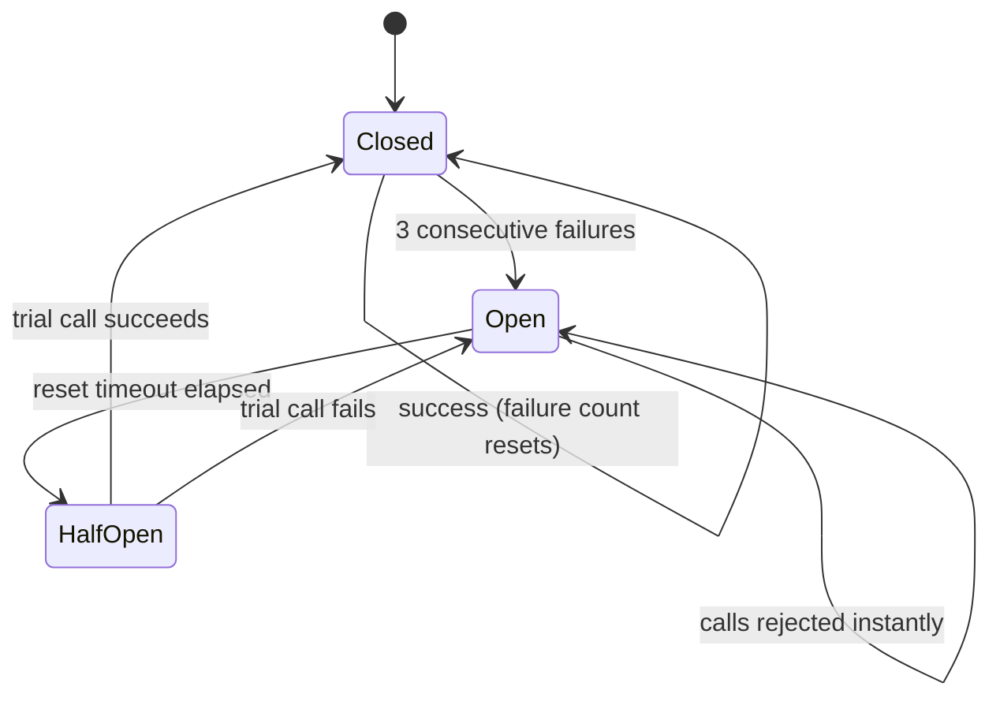

# Design decisions and findings

This document explains why the system is built the way it is, what building and testing it revealed, and where its limits are. It is written to be reused in the project report.

## 1. Approach

Resilience is treated as a requirement that can be tested automatically, like functionality. The approach has three parts:

1. **An application with explicit resilience policies.** Timeouts, retries, circuit breakers and fallbacks are implemented in small, readable modules rather than hidden in libraries, so each behaviour can be explained and tested.
2. **A fault-injection environment that is identical everywhere.** Docker Compose starts the app, PostgreSQL, Redis and Toxiproxy the same way on a laptop, in GitHub Actions and in Jenkins. The test runner itself is a container on the same network, so the CI machine needs nothing but Docker.
3. **Objectives, not implementation details, as pass criteria.** The tests measure what a client experiences (status codes, latency, data correctness, recovery time) against fixed service-level objectives.

## 2. Findings

These came out of building and testing the system. Each is reproducible with the repository.

### 2.1 Library defaults are unsafe for optional dependencies

redis-py 8 defaults to a 5-second socket timeout and **10 automatic retries with exponential backoff**. For a database that might be the right trade-off; for a cache it is the wrong one, because the whole point of a cache is to be faster than the database. With those defaults a slow Redis node can stall each request for close to a minute. The app overrides both (`catalog/cache.py`), and mutation D shows the suite catching a regression to the defaults: the suite's runtime alone jumps from about 18 s to about 87 s.

### 2.2 Per-read timeouts do not bound a request: delays add up across round trips

pg8000's `timeout` applies to each socket read. Measured through Toxiproxy with 1 s of latency per reply:

| Operation | Network round trips | Time at 1 s per reply |
|---|---|---|
| Query without parameters | 1 | 1.0 s |
| Query with parameters (every query in this app) | 3 | 3.0 s |
| Opening a connection (startup + SCRAM authentication) | 6 | 6.0 s |

So a reply delay just under the timeout passes every individual read, yet a request can take three to nine times the intended limit. The first version of the app had exactly this gap. A new scenario (700 ms per reply) proved it: the app answered `200` after **2.11 s**, missing the 2 s objective. The fix runs each operation on a worker thread and stops waiting at a deadline for the *whole* operation (`PostgresRepository._query`), keeping the socket timeout as a backstop for the abandoned thread. After the fix the same scenario returns `503` in 1.00 s, while 150 ms of latency still succeeds in 0.46 s.

The same arithmetic explains mutation B: with the timeout loosened to 10 s, a 3-second database delay made users wait **9.01 s** (three round trips of 3 s).

### 2.3 Tests must not read their pass criteria from the system under test

The first draft of the suite derived its time budgets from the app's own settings, for example "a slow-Redis read must finish within two Redis timeouts". Mutation testing exposed the flaw: when the Redis timeout was loosened to 5 s, the budget grew to 10 s and the test passed. Only one of the four related scenarios caught the regression. After the budgets became fixed objectives (`SLO_*` in `tests/resilience/conftest.py`), three scenarios caught it. Settings are still read from the app, but only to *drive* the tests, for example how many failures should open a circuit.

### 2.4 Unit tests and fault injection catch different classes of bug

Eight regressions were injected, one at a time (README, "Testing the tests"). All four **code** regressions were caught by both unit tests and resilience tests. All four **configuration** regressions (timeouts, retries, breaker threshold) passed all 94 unit tests and were caught **only** by the resilience stage. Configuration is part of the system's behaviour, and only testing the configured system verifies it.

## 3. Design decisions

| Decision | Alternatives considered | Reason |
|---|---|---|
| Inject faults at the network layer with Toxiproxy | Stopping containers (`docker stop`), mocking clients | Stopping a container only simulates "down"; mocks never exercise the real driver. Toxiproxy reproduces slow, lossy, fragmented and half-open networks against the real PostgreSQL and Redis protocols, and its API makes every fault scriptable and reversible. |
| pg8000 driver | psycopg | Pure Python (no compiler in the image) and a socket timeout that applies to every read. libpq-based drivers offer connection and keepalive timeouts but no timeout on waiting for a query's reply, and `statement_timeout` runs on the server, where a slow network is invisible. |
| Retry only reads, and only on connection errors | Retry everything | Retrying a write whose reply was lost can insert it twice. Retrying a timeout makes a slow database slower. A dropped connection is the case where a retry on a fresh connection usually succeeds. |
| Circuit breaker wraps the retried operation | Breaker inside the retry loop | One logical call counts as one success or failure, so a blip absorbed by a retry does not move the breaker toward opening. |
| One breaker per dependency | One global breaker | Redis failing must not stop database traffic, and the reverse. |
| Serve stale cache when PostgreSQL fails | Always return 503 | For a catalog, slightly old data beats an error. Entries are kept for an hour but count as fresh for only 30 s, and stale responses are labelled. |
| Liveness separate from readiness | One health endpoint | A database outage should take an instance out of rotation (readiness), not get a healthy process restarted (liveness). |
| Build once, promote the same image | Rebuild for each stage | The published and deployed image is byte-for-byte the one that passed the fault-injection suite. |
| Test runner in a container on the Compose network | Run pytest on the CI host | Identical behaviour on GitHub Actions, Jenkins and laptops; no Python needed on the CI machine; no host networking assumptions. |
| Toxiproxy config injected by Compose (`configs.content`) | Bind-mounting a JSON file | Compose copies the content into the container through the Docker API, which also works when Jenkins runs in a container and talks to the host's Docker daemon, where bind-mount paths break. |
| Deploy through a self-hosted runner | SSH from a hosted runner, a PaaS | Works on a laptop or any VM with no SSH keys or cloud-specific tooling, and the same script performs smoke testing and rollback. |

## 4. How the circuit breaker works

Only dependency failures (timeouts, refused or dropped connections) count. A SQL error proves the database answered, so it counts as a success for availability purposes. In the half-open state exactly one trial call is let through; concurrent callers are rejected until it finishes. A call that started before the circuit opened and fails afterwards does not extend the open period.

## 5. Limitations and future work

- **Breaker state is per process.** The app runs one process, so this is exact here; with several replicas each would learn about an outage separately. A shared store, or a service mesh such as Istio or Linkerd, would coordinate them.
- **Writes are not retried.** Safe write retries need idempotency keys (the client sends a unique key; the server stores it with the write and ignores repeats). That is the natural next step.
- **No bulkhead.** The database worker pool bounds concurrent queries, but there is no explicit limit per endpoint or per client. Under heavy load a separate concurrency limit with fast rejection would protect the service further.
- **Network faults only.** Toxiproxy cannot simulate disk-full, data corruption, clock skew or a database that answers with errors. Those need other tools, such as Chaos Mesh, Pumba or fault-injecting database proxies.
- **Timing-based assertions.** Objectives are measured in wall-clock time. They have generous margins and were stable across repeated runs, but a heavily overloaded machine can still miss them; the `SLO_*` variables exist for that case.
- **Observability.** Counters are exposed as JSON on `/status`. A production system would export them to Prometheus and alert on breaker state changes.
- **Beyond CI.** The same faults could run continuously in a staging environment (continuous chaos), or in Kubernetes with tools such as Chaos Mesh or Litmus.
